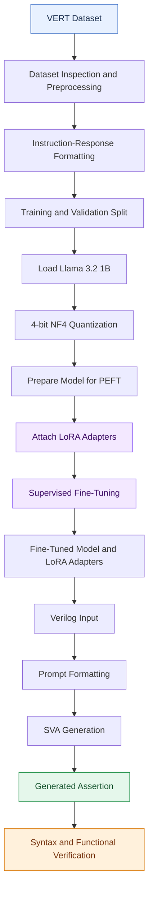
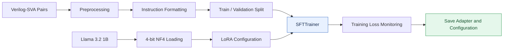
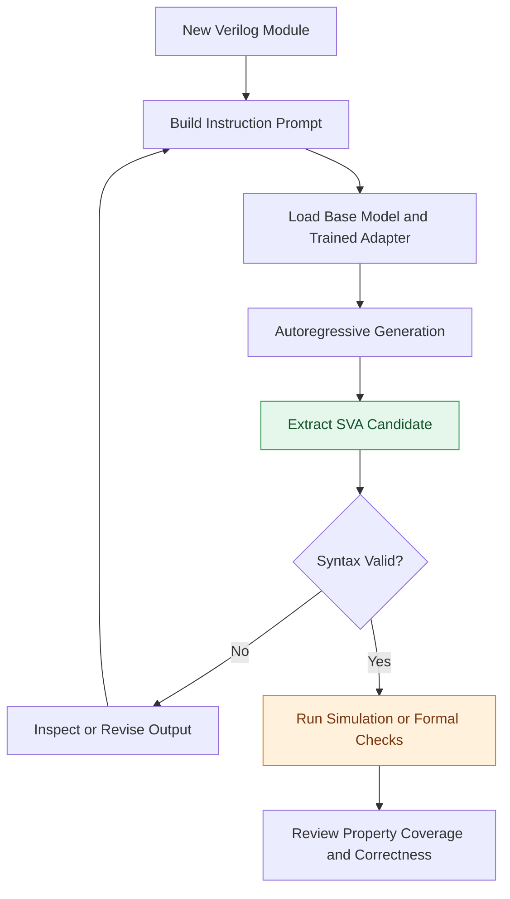

# HDL Verification CA Extra
### Automated SystemVerilog Assertion Generation Using Fine-Tuned Llama 3.2 1B

Fine-tuning Meta's Llama 3.2 1B language model using LoRA and 4-bit quantization to automate SystemVerilog Assertion (SVA) generation from Verilog hardware descriptions.

<p align="center">
  
  
  
  
  
  
  
</p>

---

## 📋 Table of Contents

- [Overview](#-overview)
- [Objectives](#-objectives)
- [System Architecture](#️-system-architecture)
- [Project Workflow](#-project-workflow)
- [Dataset](#-dataset)
- [Methodology](#️-methodology)
  - [Base Model](#1-base-model)
  - [4-Bit Quantization](#2-4-bit-quantization)
  - [LoRA Fine-Tuning](#3-lora-fine-tuning)
  - [Training Configuration](#4-training-configuration)
- [Inference Pipeline](#-inference-pipeline)
- [Installation and Usage](#-installation-and-usage)
- [Evaluation and Results](#-evaluation-and-results)
- [Limitations and Future Work](#-limitations-and-future-work)
- [Project Structure](#-project-structure)
- [Technologies](#-technologies)
- [Course Information](#-course-information)
- [Acknowledgments](#-acknowledgments)
- [Author](#-author)
- [License](#-license)

---

## 📖 Overview

Functional verification is a critical stage in digital hardware design. It helps engineers determine whether a hardware implementation satisfies its intended functional requirements.

**Assertion-Based Verification (ABV)** enables designers to express expected hardware behavior using formal properties written in SystemVerilog Assertions (SVA). These assertions can be used with simulation and formal verification tools to detect design errors and verify temporal relationships between signals.

However, manually developing high-quality assertions requires hardware verification expertise and can be time-consuming.

This project explores the use of Large Language Models (LLMs) to automate part of this process. A pretrained **Llama 3.2 1B** model is fine-tuned on Verilog-to-SVA examples from the VERT dataset to generate assertions conditioned on hardware source code and associated instructions.

To make fine-tuning practical on limited GPU resources, the implementation combines:

- **4-bit NF4 quantization** to reduce the memory footprint of the pretrained model.
- **Low-Rank Adaptation (LoRA)** to train a small set of additional parameters instead of updating all base-model weights.
- **Supervised Fine-Tuning (SFT)** to adapt the model to the task of generating hardware verification assertions.
- **Google Colab** to provide an accessible GPU-based experimentation environment.

The project was developed as the final assignment for the Functional HDL Verification course at the University of Tehran.

## 🎯 Objectives

The primary objectives are:

1. **Automate assertion generation:** Generate SVA candidates from Verilog hardware descriptions.
2. **Adapt a pretrained LLM:** Specialize a general-purpose language model for a hardware verification task.
3. **Reduce training resource requirements:** Combine 4-bit quantization with parameter-efficient fine-tuning.
4. **Explore AI-assisted verification:** Investigate how generative models can support Assertion-Based Verification workflows.
5. **Establish a reproducible experimentation pipeline:** Organize dataset preparation, model fine-tuning, and inference within a notebook-based workflow.

---

## 🏗️ System Architecture

The proposed system follows a supervised fine-tuning pipeline. Verilog code and its corresponding assertion are formatted as training examples, used to adapt the pretrained model, and then supplied to the fine-tuned model during inference.

### Overall System Model



*Figure 1. End-to-end architecture for fine-tuning an LLM and generating hardware assertions. Syntax and functional verification are downstream validation stages; generated assertions should not be considered verified automatically unless those checks are implemented and executed.*

### Core Components

| Component | Purpose |
|---|---|
| VERT dataset | Provides paired Verilog code and SVA examples. |
| Preprocessing | Converts raw examples into a consistent instruction-response format. |
| Llama 3.2 1B | Provides the pretrained language model. |
| 4-bit NF4 quantization | Reduces the memory required for model weights. |
| LoRA adapters | Introduce trainable low-rank updates to selected model layers. |
| SFTTrainer | Coordinates supervised fine-tuning. |
| Inference pipeline | Generates candidate assertions for unseen hardware inputs. |
| Verification tools | Can check syntax, elaboration, and functional properties independently. |

## 🔄 Project Workflow

The implementation can be divided into two phases: model adaptation and assertion generation.

### Phase 1: Model Fine-Tuning



### Phase 2: Assertion Generation



*Figure 2. Conceptual inference workflow. The validation and revision steps describe the intended verification process; automated feedback loops require additional implementation.*

---

## 📊 Dataset

The project uses the **VERT (Verilog to SystemVerilog Assertions)** dataset.

**Dataset repository:** [AnandMenon12/VERT](https://github.com/AnandMenon12/VERT)

The dataset contains examples connecting hardware implementations with their corresponding assertions.

### Data Fields

| Field | Description |
|---|---|
| `Code` | Verilog hardware implementation. |
| `Assertion` | Associated SystemVerilog Assertion. |
| `Synchronous` | Metadata describing synchronous behavior. |
| `Clock` | Clock-related information. |

The exact available metadata and field values depend on the dataset records.

### Preprocessing Pipeline

1. Load the dataset and inspect its structure.
2. Extract the Verilog code and corresponding assertion.
3. Format each example as an instruction-response pair.
4. Split the examples into training and validation subsets.
5. Prepare the formatted examples for supervised fine-tuning.

The instruction-response approach encourages the model to treat Verilog code as input context and SVA generation as its target task.

---

## ⚙️ Methodology

### 1. Base Model

The selected base model is [Meta Llama 3.2 1B](https://huggingface.co/meta-llama/Llama-3.2-1B).

Its relatively small parameter count makes it suitable for experiments with resource-constrained GPU environments compared with substantially larger LLMs.

The model is adapted to hardware assertion generation through supervised fine-tuning rather than training a language model from scratch.

### 2. 4-Bit Quantization

The model is loaded using **4-bit NormalFloat (NF4)** quantization through `bitsandbytes`.

Key benefits include:

- Reduced memory consumption for model weights.
- More accessible fine-tuning on consumer and cloud GPUs.
- Compatibility with parameter-efficient adaptation workflows.

Quantization reduces storage requirements, but it does not guarantee identical generation quality to full-precision inference. Runtime memory also depends on activations, sequence lengths, optimizer state, and other implementation details.

### 3. LoRA Fine-Tuning

**Low-Rank Adaptation (LoRA)** introduces trainable low-rank matrices into selected layers while keeping the pretrained weights frozen.

The low-rank updates can be expressed as:

\[
W' = W + \Delta W
\]

where

\[
\Delta W = BA
\]

and \(A\) and \(B\) are trainable low-rank matrices.

For a rank \(r\), the trainable parameter count for an adapted linear layer is approximately \(r(d_{\text{in}}+d_{\text{out}})\), instead of \(d_{\text{in}}d_{\text{out}}\) parameters for a full weight update.

#### LoRA Configuration

| Parameter | Value |
|---|---|
| Rank (`r`) | 16 |
| LoRA alpha | 32 |
| Target modules | `q_proj`, `k_proj`, `v_proj`, `o_proj` |
| Additional target modules | `gate_proj`, `up_proj`, `down_proj` |
| Base-model weights | Frozen during adapter training |

The configuration allows the model to specialize in SVA generation while training substantially fewer parameters than full fine-tuning.

### 4. Training Configuration

| Component | Configuration |
|---|---|
| Fine-tuning method | Supervised Fine-Tuning (SFT) |
| Training framework | Hugging Face TRL |
| Trainer | `SFTTrainer` |
| Quantization | 4-bit NF4 |
| Adapter method | PEFT / LoRA |
| Optimizer | Paged AdamW (32-bit) |
| Training precision | FP16 mixed precision |
| Compute environment | Google Colab GPU |
| Example GPU environment | NVIDIA Tesla T4 |

Gradient accumulation can be used to increase the effective batch size without requiring all samples in the effective batch to be processed simultaneously.

The exact learning rate, number of epochs, sequence length, batch size, and gradient accumulation settings should be taken from the configuration used in the notebook.

---

## 🚀 Inference Pipeline

Once fine-tuning is complete, the model can be used to generate candidate assertions for new Verilog modules.

### Input

A hardware module supplied as Verilog code, accompanied by an instruction asking the model to generate an appropriate assertion.

### Processing

1. Format the Verilog module into the expected prompt structure.
2. Load the pretrained base model and the trained LoRA adapter.
3. Generate a response using autoregressive decoding.
4. Extract the generated assertion from the response.
5. Review and validate the assertion using suitable HDL verification tools.

### Output

A candidate SystemVerilog Assertion intended to express a property of the supplied hardware design.

**Important:** A syntactically valid assertion is not necessarily semantically correct. Assertions should be checked against the intended design behavior, clocking assumptions, reset conditions, and verification requirements.

---

## 📈 Evaluation and Results

The main evaluation goal is to determine whether fine-tuning improves the model's ability to generate valid and meaningful SystemVerilog Assertions from Verilog code.

### Recommended Evaluation Metrics

| Metric | What It Measures |
|---|---|
| Syntax validity rate | Fraction of generated assertions accepted by an appropriate SystemVerilog parser or tool. |
| Exact match | Fraction of outputs identical to the reference assertions after a defined normalization procedure. |
| Functional correctness | Whether the generated property expresses the intended hardware behavior. |
| Pass rate | Fraction of generated properties that pass the specified verification checks. |
| Generation latency | Time required to generate an assertion. |
| Peak GPU memory | Maximum GPU memory consumed during inference or training. |

Exact match alone is insufficient because multiple different assertions may correctly express the same property.

### Results Reporting

The repository provides the implementation notebook, but quantitative performance values should be reported only after running the corresponding evaluation.

Recommended additions after evaluation include:

- Training and validation loss curves.
- A comparison of the base model and fine-tuned model.
- Representative Verilog inputs and generated assertions.
- Syntax validation statistics.
- Inference latency and GPU memory measurements.

No quantitative accuracy or performance improvement is claimed here without measured experimental evidence.

---

## 🛠️ Installation and Usage

The main implementation is provided as a Jupyter notebook and can be executed in Google Colab.

### Prerequisites

- Python 3.10 or a compatible environment.
- Access to a GPU for practical fine-tuning.
- A Hugging Face account.
- Access authorization for `meta-llama/Llama-3.2-1B`.
- The required Python libraries.

### Option 1: Google Colab

1. Open the notebook in this repository:

   [CA_Extra_v1.ipynb](https://github.com/bhzadjnty7/HDL_Verification_CA_Extra/blob/main/CA_Extra_v1.ipynb)

2. Select a GPU runtime.

3. Configure your Hugging Face authentication securely.

4. Execute the notebook cells in order, including dataset loading, preprocessing, model preparation, fine-tuning, and inference.

5. Inspect the generated assertions and evaluate them using appropriate verification tools.

### Option 2: Clone the Repository

```bash
git clone https://github.com/bhzadjnty7/HDL_Verification_CA_Extra.git

cd HDL_Verification_CA_Extra
```

The repository includes the notebook, course guide, and license. Follow the dependency-installation instructions provided in the notebook.

If you create a `requirements.txt` file containing the project's tested dependencies, you can install them with:

```bash
pip install -r requirements.txt
```

### Key Dependencies

The implementation uses the following Python libraries:

```bash
pip install torch transformers datasets peft bitsandbytes trl accelerate
```

Package versions should be aligned with the versions supported by your selected Python, PyTorch, CUDA, and GPU environment.

### Hugging Face Authentication

Authenticate using a Hugging Face access token with the required model permissions.

Do not commit access tokens, credentials, or other secrets to the repository.

---

## 🔬 Limitations and Future Work

Although fine-tuned LLMs can help automate assertion authoring, several challenges remain.

### Current Limitations

- **Syntactic reliability:** Generated code may contain invalid SystemVerilog syntax.
- **Semantic correctness:** An assertion may be syntactically valid but fail to represent the intended behavior.
- **Clock and reset handling:** Correct temporal properties depend on appropriate clocking events, reset assumptions, and signal semantics.
- **Dataset coverage:** Performance depends on the variety and quality of the available training examples.
- **Generalization:** Performance on unseen modules and hardware design styles requires systematic evaluation.
- **Verification integration:** Generated assertions require integration with simulation or formal verification tools to establish their usefulness.

### Future Improvements

- **Automated syntax validation:** Integrate a SystemVerilog parser or compiler into the evaluation pipeline.
- **Formal verification feedback:** Use simulation or formal tools to assess generated properties against the design.
- **Baseline comparisons:** Compare the fine-tuned model with the original model and alternative fine-tuning configurations.
- **Data augmentation:** Expand coverage of temporal operators, reset behavior, counters, state machines, and protocol properties.
- **Evaluation automation:** Build a benchmark that measures syntax validity, semantic correctness, generation latency, and memory use.
- **Model comparison:** Evaluate different model sizes and architectures under consistent experimental conditions.
- **Assertion refinement:** Explore feedback-driven generation to revise invalid or incorrect properties.

---

## 📁 Project Structure

```text
HDL_Verification_CA_Extra/
│
├── CA_Extra_v1.ipynb
│   └── Dataset preparation, model fine-tuning, and experiments
│
├── CA_EXTRA_Guide.pdf
│   └── Course assignment guide
│
├── LICENSE
│   └── Repository license
│
└── README.md
    └── Project documentation
```

This structure reflects the files currently present in the repository. Additional evaluation scripts, model adapters, or result plots can be added as the project evolves.

---

## 🧰 Technologies

| Technology | Role |
|---|---|
| Python | Implementation language |
| PyTorch | Model training and inference |
| Hugging Face Transformers | Pretrained model loading |
| Hugging Face Datasets | Dataset preparation |
| PEFT | Parameter-efficient fine-tuning |
| bitsandbytes | 4-bit model quantization |
| TRL | Supervised fine-tuning |
| Accelerate | Training and hardware support |
| Google Colab | Cloud-based experimentation |
| SystemVerilog | Assertion language for hardware verification |
| Mermaid | Architecture and workflow diagrams |

---

## 🎓 Course Information

- **Course:** Functional HDL Verification
- **Instructor:** Dr. Siamak Mohammadi
- **Institution:** University of Tehran
- **Semester:** Fall 2025 (Autumn 1404)
- **Teaching Assistants:** Behzad Jannati, Mahsa Abarghani Aghdam

This project was developed as the final assignment for the course.

---

## 🙏 Acknowledgments

The project builds on the work of the open-source hardware verification and machine learning communities.

- **VERT Dataset:** [AnandMenon12/VERT](https://github.com/AnandMenon12/VERT)
- **Meta Llama:** [Llama 3.2 1B](https://huggingface.co/meta-llama/Llama-3.2-1B)
- **Hugging Face:** Transformers, PEFT, Datasets, and TRL libraries.
- **bitsandbytes:** Quantization support for memory-efficient model loading and fine-tuning.

We acknowledge the instructor and course staff of Functional HDL Verification at the University of Tehran for the educational context of this work.

---

## 👨‍💻 Author

**Behzad Jannati**

M.Sc. Student — Computer Engineering, Computer Architecture  
University of Tehran

- **GitHub:** [bhzadjnty7](https://github.com/bhzadjnty7)
- **LinkedIn:** [behzadjannati](https://www.linkedin.com/in/behzadjannati)

**Research interests:** Large Language Models, AI-assisted hardware verification, parameter-efficient fine-tuning, and hardware/software co-design.

---

## 📄 License

This project is distributed under the license specified in the repository's [`LICENSE`](https://github.com/bhzadjnty7/HDL_Verification_CA_Extra/blob/main/LICENSE) file.

Please refer to that file for the applicable terms.

---

<p align="center">
  <sub>Built with ❤️ using Python, Hugging Face, PyTorch, and Google Colab.</sub>
</p>
